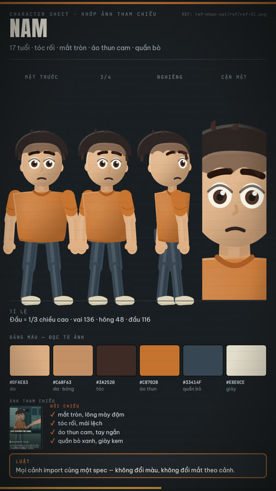
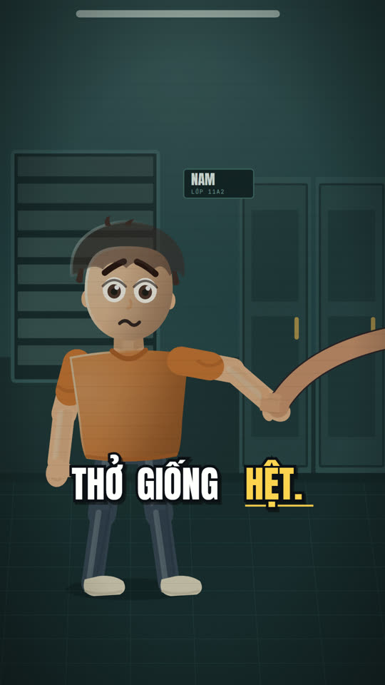
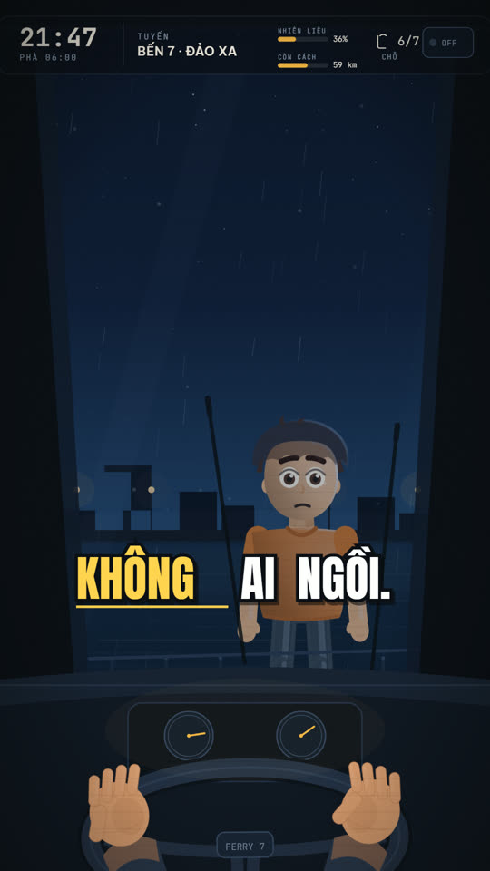
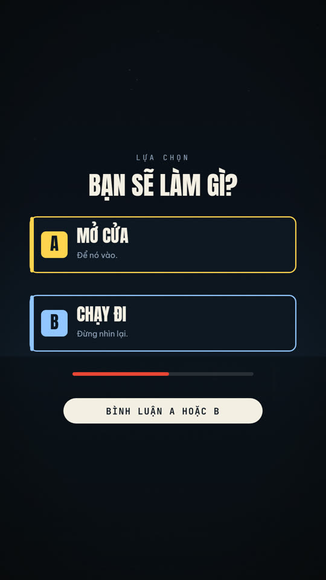

# Studio — skill làm video dọc cho agent

Bộ skill tự chứa để biến một ý tưởng thành **video dọc 1080×1920, 30fps, H.264/AAC** kiểu Reels/TikTok:
kịch bản → lời thoại tiếng Việt → hình → caption all-caps → nhạc/SFX → render MP4, kèm cổng review
tự bắt lỗi trước khi đăng.

Repo này là nơi học và tái sử dụng: mỗi lần thêm một năng lực mới (nhân vật theo ảnh tham chiếu,
giọng đọc local, epilogue nối vũ trụ…) thì cập nhật thẳng vào skill để lần sau agent dùng lại được.

| Bảng nhân vật (frame duyệt) | Hành lang theo ảnh | Cabin nối `chuyen-pha` | Thẻ A/B |
|---|---|---|---|
|  |  |  |  |

## Có gì trong này

```
video-pipeline/                 # skill + engine (Remotion + Python)
├─ SKILL.md                     #   hướng dẫn cho agent (đọc file này trước)
├─ QUY-TRINH.md                 #   quy trình tiếng Việt, từng bước
├─ video.py                     #   CLI: doctor/new/voice/subs/timeline/audio/stills/review/render/pack
├─ pipeline/                    #   voice (edge-tts + VieNeu), subs, timeline, score, review, validate
├─ src/engine/                  #   rig.tsx (Hero), flat.tsx (FlatHero), character.tsx (spec + sheet),
│                               #   firstPerson.tsx (Cabin, Hud, NightSea, Caption, ChoiceCard…)
├─ src/episodes/chuyen-pha/     #   9 cảnh, 42s — ví dụ gốc
├─ src/episodes/ref-nhan-vat/   #   nhân vật khoá theo ảnh: sheet 4 góc + 4 cảnh + thẻ A/B
├─ src/episodes/chuyen-pha-sau/ #   epilogue 19s nối vào chuyen-pha, dùng nhân vật của sheet
└─ reference/                   #   style.md, character-ref.md, qa.md, prompt-pack.md
```

## Ba thứ đáng học nhất

### 1. Nhân vật phải trông như ảnh

Ảnh tham chiếu là hợp đồng, không phải cảm hứng. Pipeline viết hợp đồng đó **một lần** bằng `CharSpec`
(`src/engine/character.tsx`): màu, tỉ lệ, kiểu mắt, tóc, tay áo. Mọi cảnh chỉ `import` lại spec, nên
nhân vật không thể "trôi" giữa các cảnh.

- Rig thứ hai `FlatHero` (`src/engine/flat.tsx`): cùng `Pose`, nhưng vẽ kiểu phẳng — khối tô kín,
  không viền, tay áo ngắn, mắt tròn, tóc rối. `Hero` cũ vẫn dùng cho phim chalkboard.
- `<CharacterSheet>` vẽ 4 góc nhìn + bảng màu + **ảnh gốc cạnh bên** + checklist 4 dòng. Đây là frame
  để duyệt trước khi dựng cảnh.
- Quy trình đầy đủ (đọc palette, viết spec, checklist 6 điểm, lỗi thường gặp):
  [`video-pipeline/reference/character-ref.md`](video-pipeline/reference/character-ref.md).

### 2. Epilogue nối vũ trụ

`chuyen-pha-sau` (19s) đưa đúng nhân vật của sheet vào vũ trụ `chuyen-pha`: boong phà đêm, HUD
`6/7 chỗ`, ghế thứ bảy, thẻ chọn A/B. Cùng `NightSea`, `Cabin`, `Hud`, `Crowd`, cùng luật caption —
nên hai video cắt cạnh nhau vẫn liền mạch.

### 3. Giọng đọc: edge-tts hoặc VieNeu-TTS

`voice.engine` trong `project.json` chọn engine:

| Engine | Cần gì | Giọng | Ghi chú |
|---|---|---|---|
| `edge-tts` (mặc định) | mạng | `vi-VN-NamMinhNeural`, `vi-VN-HoaiMyNeural` | nhanh, không key |
| `vieneu` | `pip install vieneu` + ~1 GB model lần đầu | 25 preset: `Hải Đăng`, `Mai Anh`, `Adam bựa`, `Thùy Dung`… | 48 kHz, clone 3–8s, `[cười]` `[thở dài]`, CPU RTF ≈ 0.5 |

`pitch`, `volume`, `loa`, `echo`, `reverb` do DSP nội bộ xử lý nên hai engine cho cùng một "chất" line.
Voice luôn được chuẩn hoá EBU R128 hai pass về **-15 LUFS / -1.5 dBTP** (đổi bằng `audio.voiceLufs`);
nhạc 0.11, SFX 0.75–0.8 — lời luôn nổi trên nền.
Nguồn VieNeu: <https://github.com/pnnbao97/VieNeu-TTS> (Apache 2.0).

## Chạy thử

```powershell
cd video-pipeline
npm install
python video.py doctor

# video nhân vật (24s)
python video.py voice ref-nhan-vat
python video.py timeline ref-nhan-vat
python video.py audio ref-nhan-vat
python video.py stills ref-nhan-vat --mid
python video.py review ref-nhan-vat
python video.py render ref-nhan-vat

# epilogue nối chuyen-pha (19s)
python video.py voice chuyen-pha-sau
python video.py timeline chuyen-pha-sau
python video.py audio chuyen-pha-sau
python video.py render chuyen-pha-sau
```

Muốn dùng VieNeu: sửa `voice.engine` thành `"vieneu"` và đặt `id` của từng role thành tên preset,
rồi chạy `python video.py voice <slug> --force` (cache `lines/*.vieneu.wav` tách khỏi edge-tts).

## Dùng như skill OpenCode trong project khác

```powershell
# Windows: junction — một nguồn, nhiều project
New-Item -ItemType Junction -Path .opencode\skills\video-pipeline -Target <repo>\video-pipeline
# hoặc copy cả folder
```

Agent đọc `video-pipeline/SKILL.md`, rồi `reference/*.md` khi cần chi tiết.

## Cấu trúc dữ liệu

`project.json` là nguồn sự thật: `shots[]` (dur, key, caption), `captions[]`, `lines[]` (at tuyệt đối),
`endCard`, `fx[]`. `timeline.json` do Python sinh ra, Remotion chỉ đọc — nên cắt cảnh không bao giờ trôi tiếng.

Caption: tĩnh, ALL CAPS, viền đen dày, một từ nhấn vàng/đỏ + gạch chân, `y` đổi theo cảnh để không che mặt.

## Ghi công & license

- VieNeu-TTS — Phạm Nguyễn Ngọc Bảo, Apache 2.0.
- Font: Anton, Be Vietnam Pro, JetBrains Mono (OFL) — đóng gói trong `public/fonts/`.
- Nhân vật trong repo là nhân vật gốc; ảnh tham chiếu chỉ dùng nội bộ để đối chiếu, không phát hành kèm.
